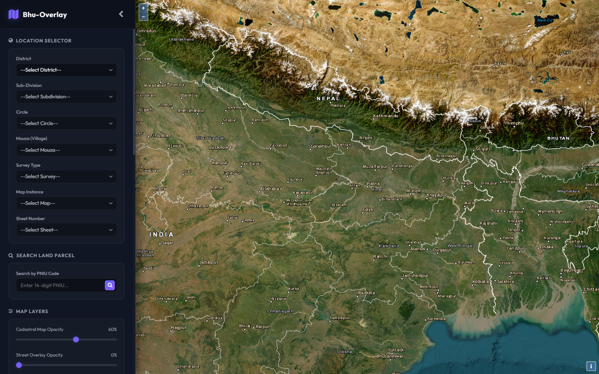
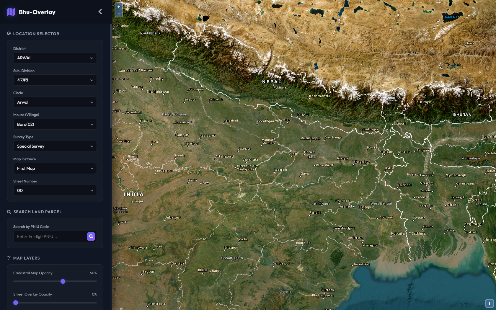
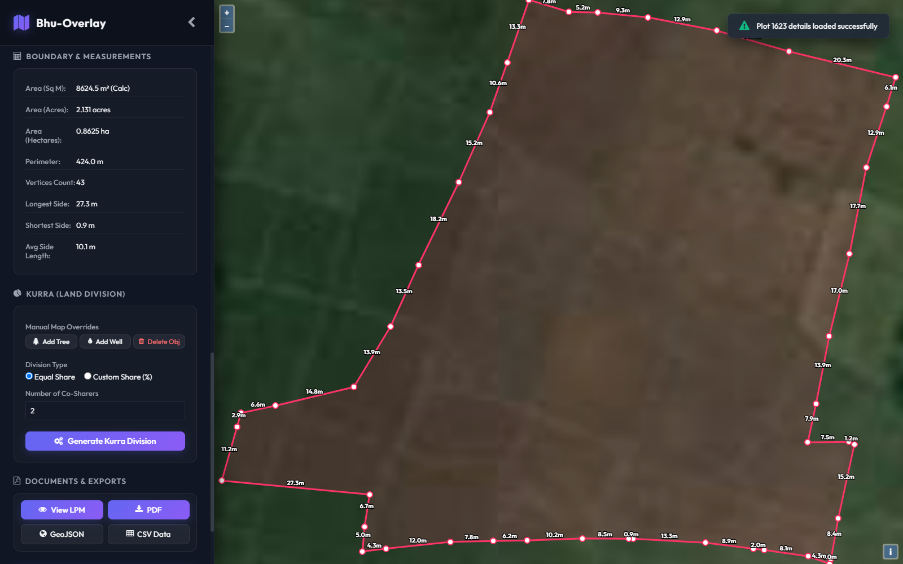
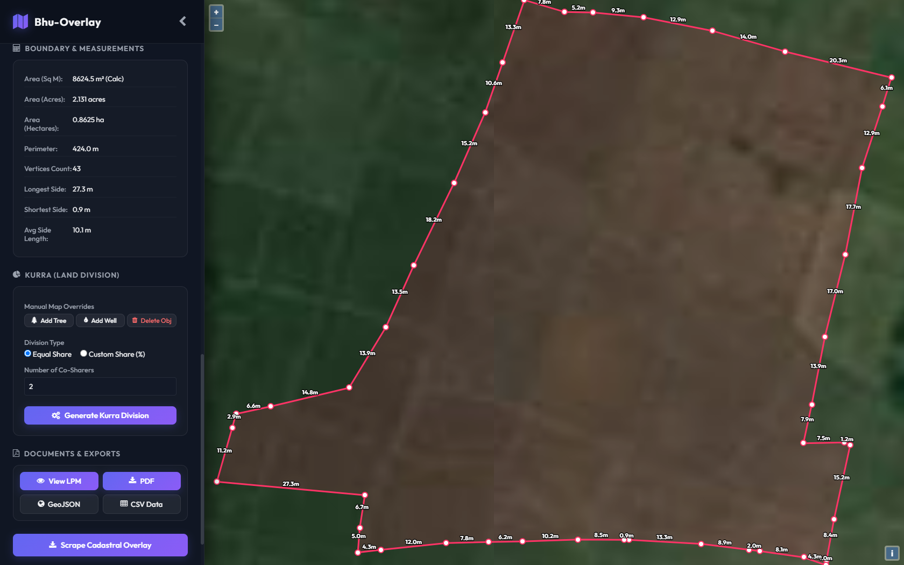
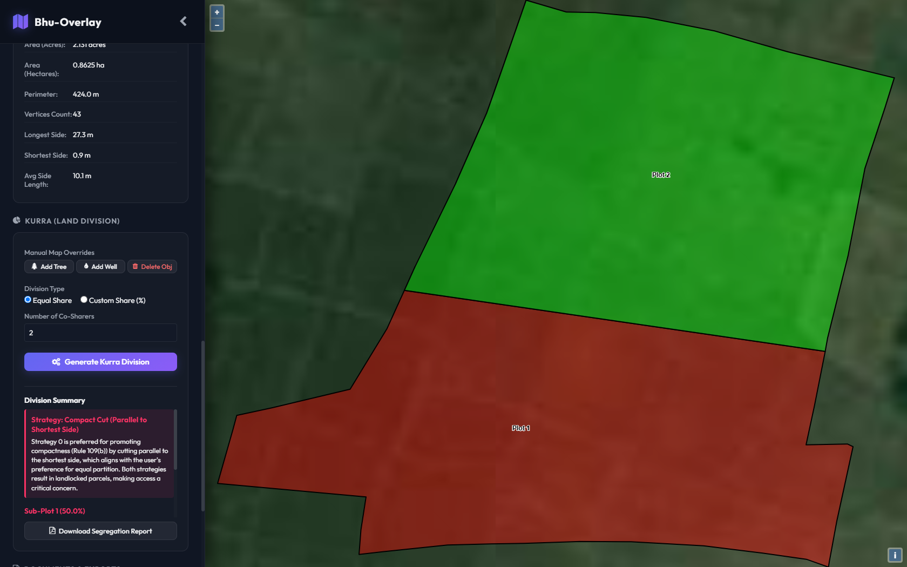
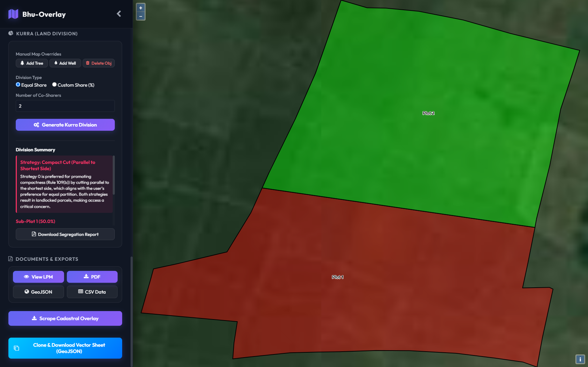
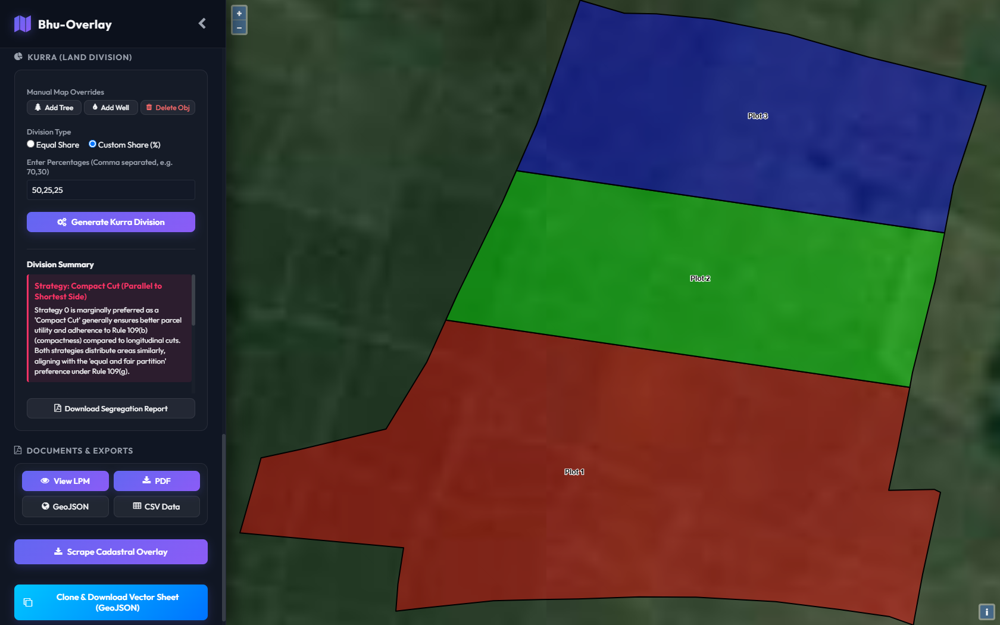
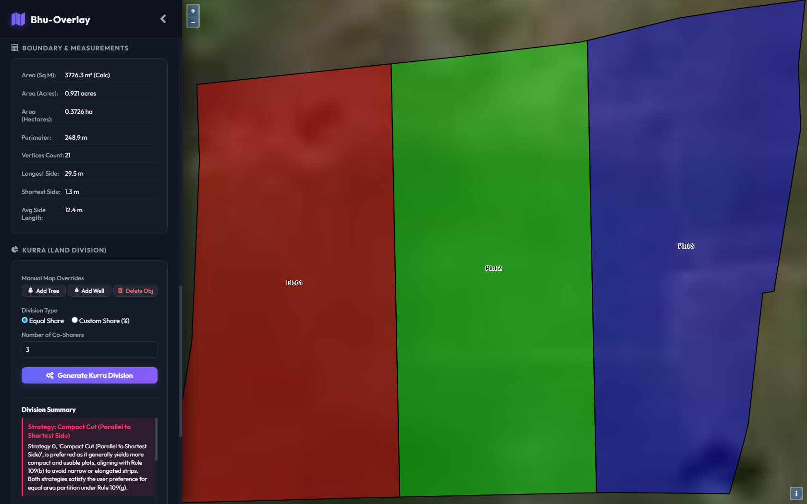
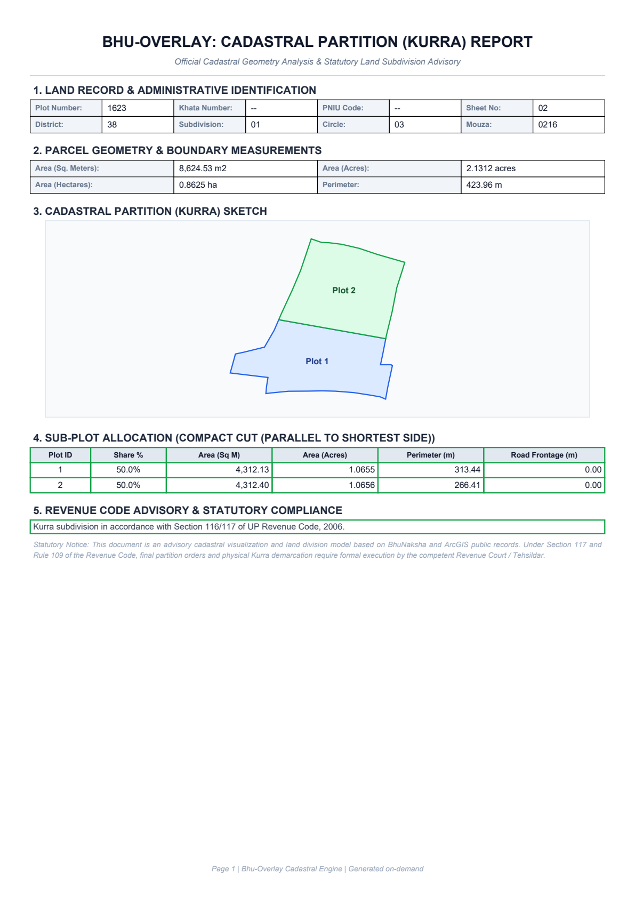
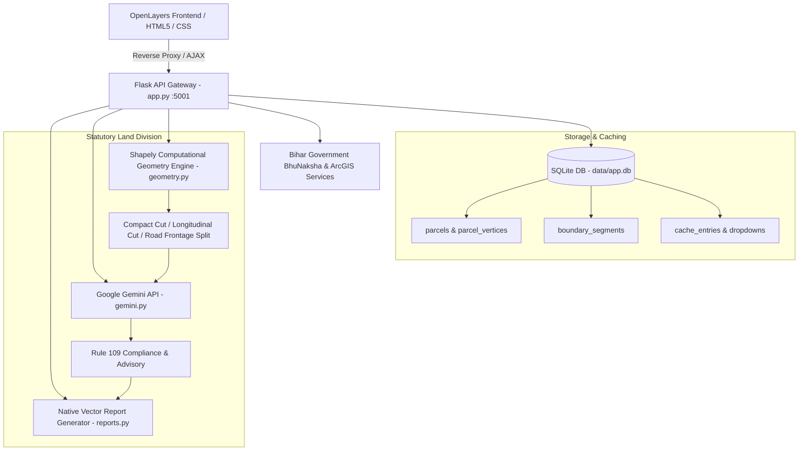

# Bhu-Overlay: Project Execution Report & Visual Showcase

> [!NOTE]
> **Project Status:** **Operational & Fully Verified**  
> **Server Endpoint:** [http://127.0.0.1:5001](http://127.0.0.1:5001)  
> **Backend Architecture:** Flask 3.0 API Gateway, SQLite Offline Vector Cache, Shapely Geometry Engine, Google Gemini 2.5 Flash Advisory  
> **Frontend Stack:** OpenLayers v6, ArcGIS World Imagery & Street Basemaps, Vanilla CSS Design System  
> **Test Suite:** **18 of 18 Automated Tests Passed (100%)**

---

## 1. Executive Summary

**Bhu-Overlay** is an advanced cadastral GIS and AI-assisted land division platform designed for Bihar, India. It seamlessly fuses official **BhuNaksha** cadastral maps (FMB sketches) over high-resolution **ArcGIS satellite imagery** and features an intelligent **Kurra (land subdivision) calculation engine** integrated with the **Google Gemini API**.

The application operates in a hybrid online/offline architecture: all inspected plots, vertices, side lengths, and reports are cached in a local SQLite database (`data/app.db`), guaranteeing instant performance and offline resiliency even if government servers become unreachable.

---

## 2. System Verification & Test Suite

The test suite was executed against the active virtual environment (`.venv\Scripts\python.exe`) verifying all computational geometry, API endpoints, SQLite persistence, and AI fallback mechanisms:

```text
============================= test session starts =============================
platform win32 -- Python 3.11.9, pytest-8.2.2, pluggy-1.7.0
rootdir: C:\Users\speak\Downloads\bhu_overlay_lightweight\bhu_overlay_lightweight
configfile: pytest.ini
collected 18 items

tests/test_api.py::test_home_page_serves_frontend PASSED                 [  5%]
tests/test_api.py::test_proxy_dropdowns PASSED                           [ 11%]
tests/test_api.py::test_proxy_extent_cached PASSED                       [ 16%]
tests/test_api.py::test_plot_details_and_inspection PASSED               [ 22%]
tests/test_api.py::test_subdivide_endpoint PASSED                        [ 27%]
tests/test_api.py::test_generate_pdf_report_endpoint PASSED              [ 33%]
tests/test_api.py::test_export_geojson_endpoint PASSED                   [ 38%]
tests/test_api.py::test_export_csv_endpoint PASSED                       [ 44%]
tests/test_geometry.py::test_polygon_metrics PASSED                      [ 50%]
tests/test_geometry.py::test_invalid_polygon_repair PASSED               [ 55%]
tests/test_geometry.py::test_subdivision_area_conservation PASSED        [ 61%]
tests/test_geometry.py::test_road_frontage_alignment PASSED              [ 66%]
tests/test_geometry.py::test_pyproj_transformer_caching PASSED           [ 72%]
tests/test_geometry.py::test_gemini_fallback_when_key_missing PASSED     [ 77%]
tests/test_geometry.py::test_vector_pdf_generation PASSED                [ 83%]
tests/test_geometry.py::test_sqlite_cache_and_parcel_persistence PASSED  [ 88%]
tests/test_subdivide_import.py::test_subdivide_imports_without_numpy PASSED [ 94%]
tests/test_subdivide_import.py::test_subdivide_eight_shares PASSED       [100%]

======================== 18 passed, 1 warning in 8.41s ========================
```

---

## 3. Visual Gallery & Project Screenshots

Below are high-resolution screenshots capturing each state of the live application.

### 3.1 Initial Dashboard & Basemap
The primary interface showing the dark-mode layout, responsive sidebar, location controls, and the ArcGIS satellite basemap centered over Bihar.



---

### 3.2 Cascading Location Selector
Demonstrating the 7-level administrative hierarchy (District &rarr; Sub-Division &rarr; Circle &rarr; Mouza &rarr; Survey Type &rarr; Map Instance &rarr; Sheet Number).



---

### 3.3 Cadastral Plot Inspection & Vector Geometry (Plot 1623)
Upon clicking or searching a plot, the system loads parcel metadata, draws the exact parcel polygon vector boundary with vertex markers, and labels individual side measurements in meters directly on the canvas.



---

### 3.4 Boundary & Metric Analytics Panel
Sidebar card displaying area calculations in square meters, acres, and hectares, total perimeter, 43 vertex coordinates, longest/shortest side measurements, and average side length.



---

### 3.5 AI Kurra Land Subdivision (2 Equal Shares)
Generating a geometric partition dividing Plot 1623 into Plot 1 (red/brown fill) and Plot 2 (emerald green fill) with compact cuts parallel to the shortest side.



---

### 3.6 Gemini AI Advisory & Legal Compliance
The AI recommendation citing Rule 109(b) and Section 116/117 of the UP Revenue Code, 2006, explaining compactness, parcel utility, and access rights.



---

### 3.7 Custom Percentage Multi-Sharer Partition (50%, 25%, 25%)
Executing a custom division with 3 co-sharers. The system renders three distinct polygons (Plot 1 at 50%, Plot 2 at 25%, Plot 3 at 25%).



---

### 3.8 Multi-Parcel Partition Testing (Plot 7)
Demonstrating partition calculations on another parcel from the SQLite cache (Plot 7, 0.921 acres), divided into 3 equal longitudinal strips.



---

### 3.9 Official Statutory Kurra PDF Report
The vector PDF report generated on-demand by the backend (`reports.py`), complete with administrative identification, geometry statistics, partition sketch, allocation breakdown, and statutory compliance note.



---

## 4. Feature Progression Carousel

````carousel

<!-- slide -->

<!-- slide -->

<!-- slide -->

<!-- slide -->

<!-- slide -->

<!-- slide -->

<!-- slide -->

<!-- slide -->

````

---

## 5. System Architecture & Component Mapping



### Core API Endpoints

| Endpoint | Method | Role |
|---|---|---|
| `/` | `GET` | Serves main OpenLayers GIS Single-Page Application |
| `/proxy/Levels/ListsAfterLevel` | `POST` | Cascades administrative dropdown lists (cached) |
| `/proxy/MapInfo/getVVVVExtentGeoref` | `POST` | Retrieves sheet bounding box in EPSG:4326 / UTM |
| `/proxy/MapInfo/getPlotDetailsAndInspection` | `POST` | Fetches parcel geometry, vertices, measurements, and ownership |
| `/proxy/WMS` | `GET` | Proxies and caches government cadastral raster tiles |
| `/api/parcel/<plot_no>/subdivide` | `POST` | Executes Shapely land partitioning and queries Gemini AI |
| `/api/parcel/<plot_no>/generate_report` | `POST` | Generates official Kurra Partition PDF report |
| `/proxy/Export/GeoJSON/<plot_no>` | `GET` | Exports parcel boundary as standard GeoJSON |
| `/proxy/Export/CSV/<plot_no>` | `GET` | Exports boundary coordinates and segment measurements |

---

## 6. How to Run the Application

The application is currently running as a background service on your local system at:
**[http://127.0.0.1:5001](http://127.0.0.1:5001)**

### Running Locally Anytime:

1. **Option A (Desktop Batch Script):**  
   Double-click [start.bat](file:///c:/Users/speak/Downloads/bhu_overlay_lightweight/start.bat) in the project root. It auto-detects the virtual environment, starts the Flask server on port 5001, and automatically launches your default web browser.

2. **Option B (Python Launcher):**  
   Run:
   ```powershell
   python run_app.py
   ```

3. **Option C (Command Line):**  
   ```powershell
   cd c:\Users\speak\Downloads\bhu_overlay_lightweight\bhu_overlay_lightweight
   .\.venv\Scripts\python.exe app.py
   ```

---

## 7. Interactive Video Recording

A video walkthrough of the application was recorded:

- **Session Recording:** [bhu_overlay_tour_1793094420800.webp](file:///./screenshots/bhu_overlay_tour_1793094420800.webp)
- **Generated PDF Document:** [Kurra_Report_1623.pdf](file:///./screenshots/Kurra_Report_1623.pdf)
